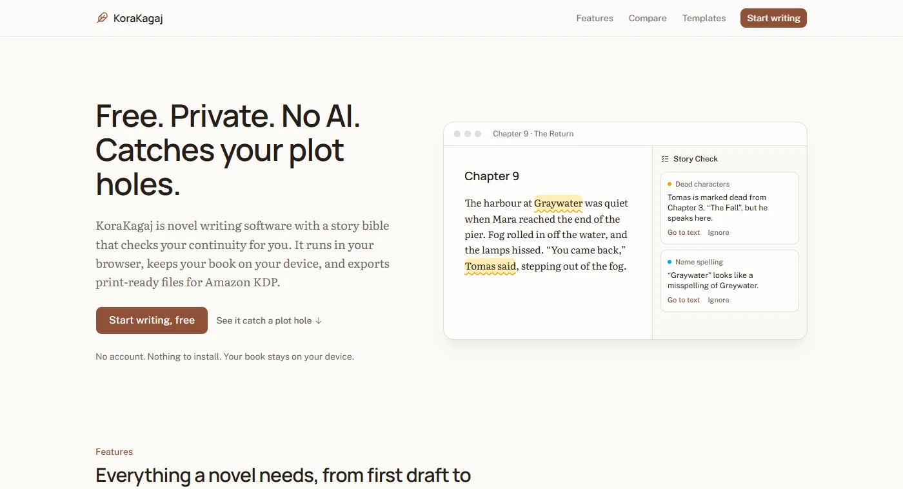
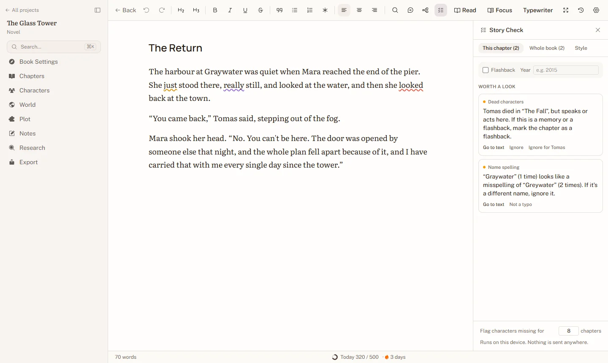
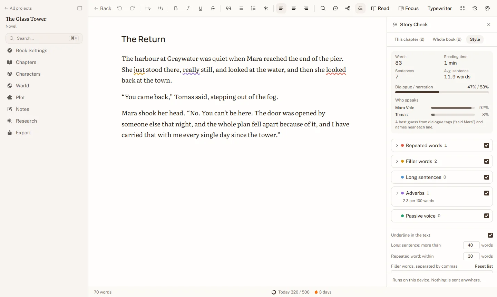
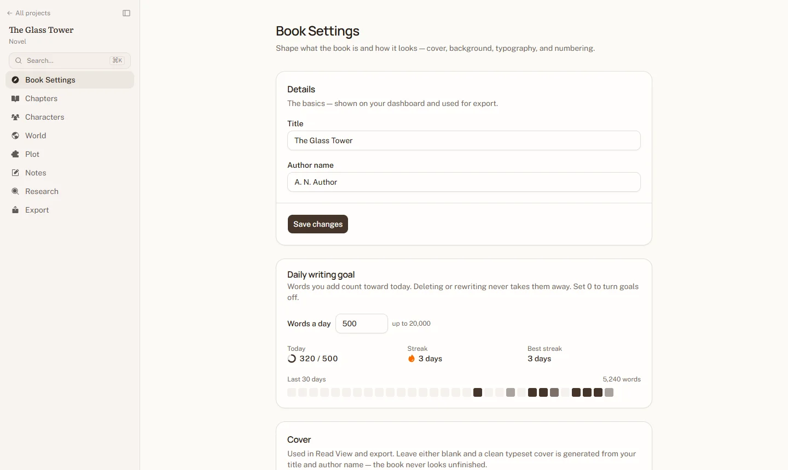
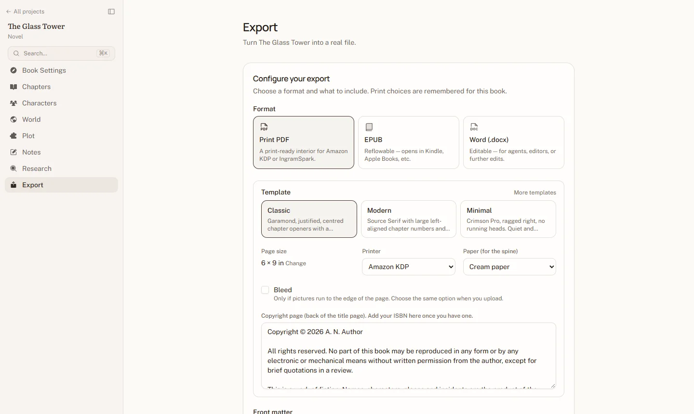

# KoraKagaj

**Free. Private. No AI. Catches your plot holes.**

KoraKagaj is free novel writing software that runs in your browser and keeps
your book on your device. It has a story bible that checks your manuscript
for continuity mistakes, style checks, daily goals, and print-ready PDFs
for Amazon KDP and IngramSpark. No account, no subscription, no AI.



| Story Check | Style checks and chapter stats |
|---|---|
|  |  |
| **Daily goals and streaks** | **Print-ready export** |
|  |  |

## Why

Most writing tools are either too simple (a folder of docs, no structure)
or too complex, and the popular new ones want a subscription and your
manuscript on their servers, often to feed an AI. KoraKagaj gives a
novelist real structure, checks the things readers notice (a dead character
who talks, a name spelled two ways), and gets out of the way. It's free
because it costs nothing to run per writer: there is no server holding books.

## Features

- **A real writing surface** — a Tiptap-based manuscript editor with
  autosave, focus/typewriter mode, and per-project customizable page
  appearance (background, header, footer, font size, line height).
- **Story Bible** — Characters, World, and Plot sections, cross-linked by
  an `@mention` system so referencing a character or place from your prose
  quietly keeps a backlink index, without ever writing for you.
- **Story Check** — continuity checks against the story bible: a dead
  character who speaks or acts, a misspelled name, eye or hair colour that
  differs from the profile, an age that doesn't match the birth year,
  forgotten characters and unresolved plot threads (`lib/story-check/`).
- **Style checks** — a Style tab in the editor's Story Check panel flags
  repeated words, filler words (your own list), long sentences, adverbs and
  passive voice, with optional coloured underlines in the text. It also
  shows chapter stats: reading time, sentence length, dialogue versus
  narration, and how much each character speaks.
- **Daily goals and streaks** — set a daily word goal per book. The editor
  shows today's progress, and Book Settings shows your streak and the last
  30 days. Deleting text never takes away from the day's count.
- **Notes & Research** — a Keep-style scratchpad for notes, and a source
  board for research: paste a URL and it's auto-fetched into a bookmark
  card (title, image, favicon), with a manual quick-note fallback for
  offline sources.
- **Per-type project ecosystems** — Novel, Poetry, Script, and Custom
  projects each get their own sidebar, defaults, and visual theme rather
  than a one-size-fits-all shape.
- **Book Settings** — front/back cover art, a back-cover blurb, chapter
  numbering styles, and export trim size; leave the cover blank and a
  clean typeset cover is generated from the title and author instead.
- **Export** — PDF, EPUB, and DOCX, built in the browser from the same
  document model, so what you see in the editor is what ships.
- **Local-first and private** — no account and no database. Everything is
  stored in your browser (IndexedDB) on your own device, and the app is an
  installable PWA that keeps working offline once opened.
- **Public pages** — a landing page, four guide pages for search, and
  privacy and terms pages live in `app/(marketing)/`, with their own header
  and footer. Competitor facts on the landing page are dated and sourced in
  `lib/marketing/comparison.ts`.

## Tech stack

| Layer | Choice |
|---|---|
| Framework | Next.js (App Router) + TypeScript |
| Storage | IndexedDB in the browser, via Dexie (`lib/store/`) |
| Editor | Tiptap |
| UI | Base UI primitives + Tailwind CSS v4, Phosphor icons |
| Export | `@react-pdf/renderer` (PDF), `docx` (DOCX), `jszip` (EPUB), all client-side |
| Offline | Hand-written service worker (`public/sw.js`), production builds only |

## Where data lives

All projects, chapters, versions, story-bible entries, notes, research,
comments, uploaded images and the daily word log live in the browser's IndexedDB, in a database
defined in `lib/store/db.ts`. Each table has typed repository functions in
`lib/store/`, and `lib/store/hooks.ts` wraps them in live React hooks that
re-render on any change, in any tab.

To change the stored shape, add a new entry to `migrations` in
`lib/store/db.ts` with the next version number (and an `upgrade` function if
old records need rewriting). Never edit an entry that has shipped.

The only server call that involves anything the writer typed is the Research
link preview: the pasted URL is sent to `app/actions/url-preview.ts`, which
fetches the page's title, image and icon. Nothing is stored on the server.

Because data is per browser, clearing site data deletes it. The app asks
for persistent storage (`navigator.storage.persist()`) and offers backups.

## Backups and project files

`lib/backup/format.ts` defines one file format for both: a zip (with the
extension from `BACKUP_FILE_EXTENSION` in `lib/brand.ts`) holding
`manifest.json`, every record in `data.json`, and the images under
`assets/`. A project file holds one book; a full backup holds every book,
Trash and history included.

- **Download and restore** are on the Settings page. A book that already
  exists can be replaced or kept alongside as a copy with fresh ids.
- **Folder backup** (Chromium browsers): a chosen folder gets a full backup
  about a minute after writing stops, one file per day for seven days
  (`lib/backup/folder.ts`, driven by `components/store/backup-agent.tsx`).
- **Reminders**: the dashboard suggests a backup after seven days without one.

When the backup layout changes, bump `BACKUP_FORMAT_VERSION`. When
`SCHEMA_VERSION` goes up, add a step to `migrateData` so older files still
import.

## Print-ready books

PDF export makes a print interior for Amazon KDP or IngramSpark
(`lib/print/`). The rules (gutter by page count, minimum margins, bleed,
spine width) live in `specs.ts`, and `render-print.tsx` lays out the book
with react-pdf and then uses pdf-lib to mirror the margins and set trim and
bleed boxes. Templates are JSON (`template.ts`, documented in
`templates/spec.md`). Three free ones are built in, with OFL fonts bundled
in `public/fonts/`. Paid packs are imported in Settings and stored locally.
The Export page also makes a one-piece cover PDF sized for the page count.

To look at the output, write sample PDFs with
`PRINT_SAMPLES=<folder> npm test -- lib/print/sample`, or time a 366-page
book with `PRINT_TIMING=<file> npm test -- lib/print/timing`.

## Configuration

No environment variables are required to run the app.

| Variable | Purpose |
|---|---|
| `NEXT_PUBLIC_APP_URL` | Optional. Public origin, e.g. `https://example.com`, for metadata, the sitemap and robots.txt |
| `NEXT_PUBLIC_ANALYTICS_SRC` | Optional. URL of a cookieless analytics script (Plausible, self-hosted Plausible or Umami) |
| `NEXT_PUBLIC_ANALYTICS_DOMAIN` | Optional. The site name for that script (`data-domain`, or Umami's website id) |

Analytics loads only when both are set, and only on the public pages, never
inside the writing app. The privacy page reads the same variables.

The product name, tagline and domain are placeholders in `lib/brand.ts`
until the final name is chosen. The donation link (`DONATE_URL`), source
link (`REPO_URL`) and privacy contact (`CONTACT_EMAIL`) are there too, and
stay hidden while empty.

## Development

```bash
npm install
npm run dev        # http://localhost:3000
npm run typecheck
npm run lint
npm test           # Vitest, against an in-memory IndexedDB
npm run build
```

The service worker is only registered in production builds (`npm run build`
then `npm start`), so development always serves fresh code.

## Contributing

See [CONTRIBUTING.md](CONTRIBUTING.md). The short version: no AI, no network
calls with anything a writer types, and never lose a writer's work.

## Licence

[GNU Affero General Public License v3.0](LICENSE). You can use, change and
share the app. If you run a changed version for other people, you must share
your changes under the same licence. Bundled fonts keep their own licences
(`public/fonts/`).
